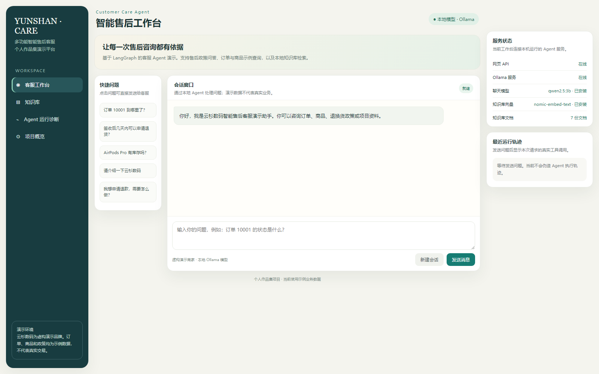
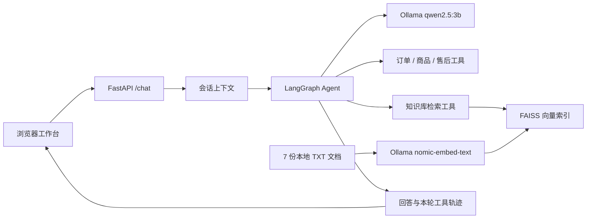

# 云杉数码 | 多功能智能售后客服

> 一个可在本地运行的电商客服 Agent 作品集项目。用户可以用自然语言咨询订单、商品、售后政策和配送；系统通过 LangGraph 选择业务工具或检索知识库，并在网页中展示本轮工具调用轨迹。

**项目性质：**个人作品集演示 · 虚构商家与业务数据 · 本地 Ollama 推理

**技术栈：**Python · FastAPI · LangGraph · LangChain · Ollama · FAISS · HTML/CSS/JavaScript

[下载一页项目介绍 PDF](portfolio/AI_Customer_Service_Agent_Portfolio.pdf)



## 可以演示什么

| 场景 | 示例提问 | 系统处理方式 |
| --- | --- | --- |
| 订单查询 | “订单 10001 到哪里了？” | 调用演示订单工具，返回该订单在示例数据中的状态 |
| 商品咨询 | “AirPods Pro 有库存吗？” | 调用演示商品工具，查询示例价格与库存 |
| 售后政策 | “签收后几天可以申请退货？” | 调用售后工具，依据演示政策回答 |
| 知识库问答 | “云杉数码是什么？配送有什么规定？” | 检索本地文档，基于命中的资料回答 |
| 多轮对话 | “我的订单号是 10001” → “它到哪里了？” | 在同一会话内关联订单号；新会话清除上下文 |

网页还提供知识库文件清单与预览、API/Ollama/模型状态，以及最近一次请求的工具决策和返回结果。演示订单、商品和政策都写在项目中，**不代表真实交易或实时数据**。

## 系统如何工作



- **Agent 编排：**`graph.py` 将聊天模型与 4 个工具绑定，模型决定是否调用工具，工具结果再返回模型生成答复。
- **知识检索：**`rag.py` 加载 `knowledge_base/` 的 7 份文本，切分后用 `nomic-embed-text` 建立进程内 FAISS 索引；`tools/rag_tool.py` 给检索片段标注来源。
- **会话与诊断：**`api.py` 按 `session_id` 保存近期对话与当前订单号，并把本轮实际工具调用转换为前端可查看的轨迹。会话数据只存在当前 Python 进程中。
- **网页界面：**`static/index.html` 提供聊天、知识库预览、运行诊断和项目概览；状态信息来自 API 的动态接口。

## 本地运行

需要 Python 3.9+ 和 [Ollama](https://ollama.com/)；首次下载模型需要网络。以下命令在项目根目录的 PowerShell 中运行：

```powershell
py -3.9 -m venv venv
.\venv\Scripts\python.exe -m pip install -r requirements.txt
ollama pull qwen2.5:3b
ollama pull nomic-embed-text
.\venv\Scripts\python.exe -m uvicorn api:app --host 127.0.0.1 --port 8000
```

确保 Ollama 服务正在运行，然后打开 `http://127.0.0.1:8000/`。API 文档在 `/docs`。修改知识库文本后，重启 API 服务以重新建立进程内索引。也可单独运行 `python rag.py` 验证索引构建。

## 项目结构

```text
api.py              FastAPI 接口、会话管理、状态与诊断轨迹
graph.py            LangGraph Agent 和工具编排
rag.py              文档加载、Embedding 与 FAISS 检索器
tools/              订单、商品、售后和知识库工具
knowledge_base/     7 份虚构商家与政策演示资料
static/index.html   网页工作台
assets/             项目运行截图
DEPLOY.md           Ubuntu 部署准备说明
```

## 当前边界与后续方向

当前版本在本机完成了网页、API、模型和知识库的联通；**尚无全天在线的公开演示地址**。订单与商品数据为代码内的示例，未接入电商、物流、退款或人工工单系统。会话重启即清空；知识检索使用进程内索引，尚未进行正式的检索准确率或客服效果评测。

后续可按需求接入持久会话、真实业务接口、检索评测与适合服务器资源的推理服务。服务器部署准备见 [DEPLOY.md](DEPLOY.md)。

> 安全说明：仓库不需要 OpenAI API 密钥；`.env`、虚拟环境和模型文件不应提交到 GitHub。真实客户信息也不应放入此演示项目。
